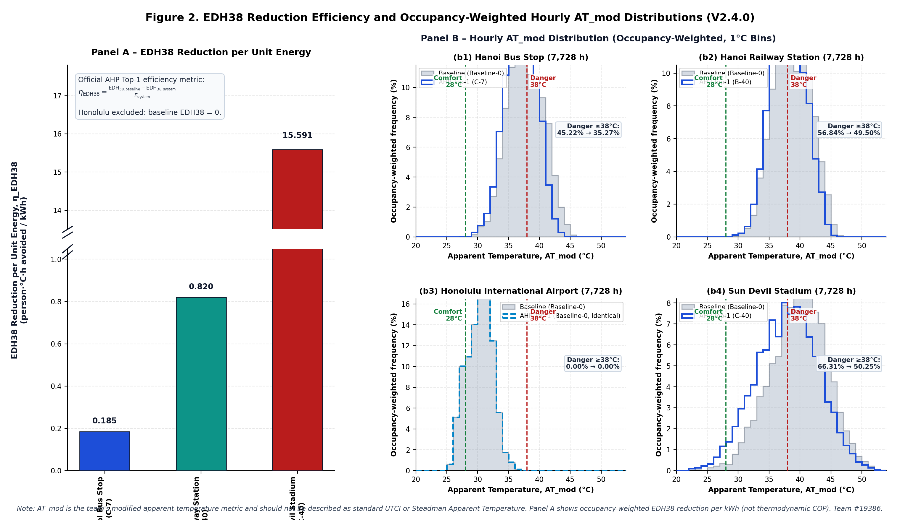
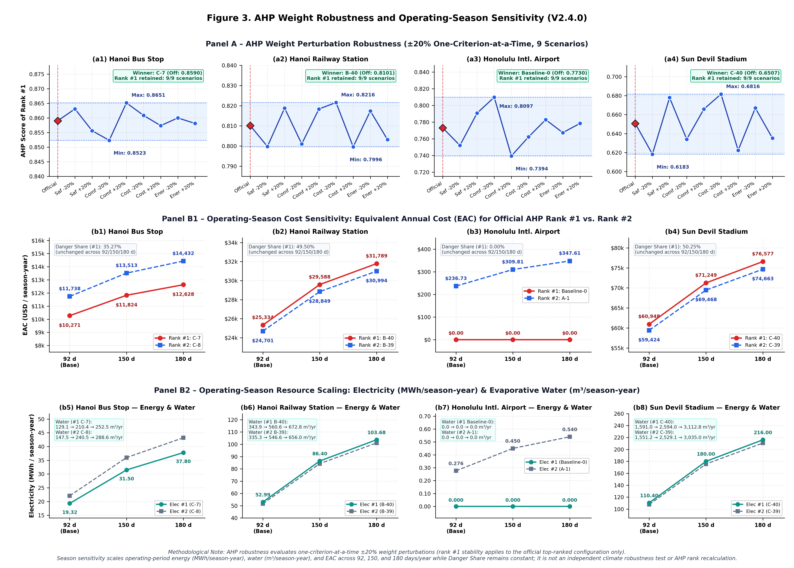

<div align="center">

# Cool the Heat, Not Just the Air: A Framework for Making Site-Specific Decisions About Outdoor and Semi-Outdoor Public Spaces

**COMAP High School Mathematical Contest in Modeling (HiMCM) 2026 — Problem B | Team #19386**

[](https://www.python.org/)
[-0F766E?style=flat-square)](#2-physical-formulation--decision-framework)
[](./02_Code_and_Reproducibility/Reproduction_Log.txt)
[](#24-multi-criteria-effectiveness-pareto--ahp)
[](#32-robustness-oat-sensitivity-heatwave-stress--monte-carlo)
[](./LICENSE)

A reduced-order, one-zone, quasi-steady hourly heat-and-moisture balance framework coupling solar and envelope gains, natural ventilation, occupant loads, served-zone crowd capture, four-objective Pareto + AHP optimization (`cap40`), and 10,000-scenario Monte Carlo uncertainty analysis.

[📄 Official Submission (PDF)](./01_Final_Report/19386.pdf) • [📊 AHP Rankings (CSV)](./04_Data_and_Results/AHP_Ranking_Official_Team19386_14Nov_v2.4.0.csv) • [🔍 Sensitivity Tracking (CSV)](./04_Data_and_Results/Sensitivity_RankTracking_LeMinh_15Nov_v5.0.csv) • [✅ Validation Audit (CSV)](./04_Data_and_Results/ValidationChecks_Team19386_14Nov_v2.4.0.csv)

</div>

> **Competition Status Notice:** Official solution package submitted to COMAP HiMCM 2026 (Problem B). Results are pending announcement by January 31, 2027.

---

## 1. Executive Summary & Core Findings

Unlike enclosed indoor rooms, open-air and semi-open public venues lose conditioned air rapidly to outdoor airflow while solar radiation and crowd density alter local thermal stress. Much like an open-front refrigerated display case—where warm air infiltration across the air curtain drives the majority of cooling load—judging public cooling by rated device capacity or electricity consumption alone misrepresents occupant protection.

Using **7,728 summer operating hours** per site (June–August 2020–2026, 09:00–21:00 local time) across four venues in three climates (**Hanoi Bus Shelter**, **Hanoi Railway Station**, **Honolulu International Airport**, and **Sun Devil Stadium in Phoenix, Arizona**), our deterministic **V2.4.0 (`cap40`)** framework evaluates three technologies against a no-cooling baseline (`Baseline-0`): recirculating fans (**System A**), medium-capacity evaporative cooling (**System B**, rated drop $5\text{ }^\circ\text{C}$), and high-capacity evaporative cooling (**System C**, rated drop $8\text{ }^\circ\text{C}$).

1. **Thermodynamics & Local Climate Govern Technology Value:** Evaporative cooling is bounded by ambient wet-bulb depression ($T_{\text{amb}} - T_{\text{wb}}$). In arid Phoenix, high-capacity evaporative cooling (`C-40`) achieves an electrical efficiency of $\eta_{\text{EDH38}} = 15.59\text{ person·}^\circ\text{C·h/kWh}$ and cuts danger share from **66.31% to 50.25%**. In humid Hanoi, narrow wet-bulb depression limits evaporative temperature drops, yielding $\eta_{\text{EDH38}} = 0.8200$ at the railway station (`B-40`) and $0.1846$ at the bus shelter (`C-7`).
2. **Site-Specific `cap40` Optima (484 Candidate Configurations → 290 Pareto-Efficient):**
   - **Sun Devil Stadium (Phoenix, AZ):** `C-40` leads `cap40` (AHP score `0.6507`), reducing cumulative Excess Degree-Hours above $38\text{ }^\circ\text{C}$ ($\text{EDH38}$) by **30.03%** and danger share from **66.31% → 50.25%** (`$60,948.07/season-year`).
   - **Hanoi Railway Station (Hanoi, Vietnam):** `B-40` leads `cap40` (AHP score `0.8101`), reducing $\text{EDH38}$ by **27.02%** and danger share from **56.84% → 49.50%** (`$25,334.40/season-year`).
   - **Hanoi Bus Shelter (Hanoi, Vietnam):** `C-7` is the mathematical AHP leader (score `0.8590`), cutting $\text{EDH38}$ by **43.63%** and danger share from **45.22% → 35.27%** (`$10,270.69/season-year`). However, mounting seven System C units on a $\approx 6.4\text{ m}^2$ shelter roof is physically unproven, so we recommend a **1–2-unit instrumented engineering pilot** prior to scaling.
   - **Honolulu International Airport (Honolulu, HI):** `Baseline-0` remains optimal (AHP score `0.7730`), as modeled baseline $\text{EDH38}$ and danger share are already **0.00%** during the operating window (leaving $\eta_{\text{EDH38}}$ undefined as $0/0$).
3. **Mechanical Cooling Alone Cannot Eliminate Extreme Heat:** Under a $+3\text{ }^\circ\text{C}$ uniform heatwave stress scenario, modeled baseline danger share rises to **81.54%** (Hanoi Bus Shelter), **88.38%** (Hanoi Railway Station), and **84.79%** (Sun Devil Stadium). Hardware must be paired with overhead shade, free hydration, dwell-time advisories, and heat-alert protocols.

### Five-Stage Simulation & Decision Pipeline

```text
+-----------------------+     +-----------------------+     +-----------------------+
| 1. Weather & Crowd    | --> | 2. Uncooled Baseline  | --> | 3. Cooling Response   |
| 7,728 Summer Hours    |     | Sol-Air, Wind+Stack   |     | System A (Air Speed)  |
| Open-Meteo (2020-26)  |     | T_base & w_zone       |     | Systems B/C (Evap.)   |
+-----------------------+     +-----------------------+     +-----------------------+
                                                                        |
+-----------------------+     +-----------------------+                 v
| 5. Multi-Criteria     | <-- | 4. Thermal Exposure   | <---------------+
| Pareto Screening +    |     | AT_mod (28 / 38 °C)   |
| AHP Ranking (cap40)   |     | S_danger, S_comf, EDH38|
+-----------------------+     +-----------------------+
```

---

## 2. Physical Formulation & Decision Framework

### 2.1 Hourly Quasi-Steady Heat & Moisture Balance

Each venue is modeled as a single control volume over $7 \times 92 \times 12 = 7{,}728$ summer operating hours ($\Delta t = 1\text{ h}$). Psychrometric properties follow Buck's saturation vapor-pressure equation and Stull's wet-bulb formulation.

**Envelope conductance and sol-air temperatures:**

$$H_{\text{env}} = U_{\text{roof}} A_{\text{roof}} + U_{\text{wall}} A_{\text{wall}} + U_{\text{glass}} A_{\text{glass}}$$

$$T_{\text{sol,roof}} = T_{\text{amb}} + \frac{\alpha_{\text{roof}} I_{\text{sol}}}{h_o} - K_{\text{rad}}(1 - 0.8\,C), \qquad T_{\text{sol,wall}} = T_{\text{amb}} + \frac{\alpha_{\text{wall}} \cdot \text{f\_dung} \cdot I_{\text{sol}}}{h_o}$$

**Glazing solar gain and internal sensible load:**

$$Q_{\text{solar,glass}} = A_{\text{glass}} \cdot \text{SHGC} \cdot \text{f\_dung} \cdot I_{\text{sol}}, \qquad Q_{\text{internal}} = N_t \cdot q_s + P_{\text{tb}}$$

**Coupled wind-driven and buoyancy-driven (stack) ventilation:**

$$v_{\text{eff}} = \max\left(k_{\text{gio}} \cdot \text{alpha\_shelter} \cdot v_{\text{amb}},\ v_{\text{min}}\right)$$

$$\dot{V}_{\text{wind}} = C_d A_{\text{open}} v_{\text{eff}}, \qquad \dot{V}_{\text{stack}} = C_d A_{\text{open}} \sqrt{\frac{g\,H\,\lvert T_0 - T_{\text{amb}} \rvert}{T_{\text{amb}} + 273.15}}, \qquad \dot{V}_{\text{inf}} = \sqrt{\dot{V}_{\text{wind}}^{2} + \dot{V}_{\text{stack}}^{2}}$$

**Baseline zone temperature and humidity ratio** (solved via two-pass predictor-corrector; open-air Sun Devil Stadium sets $w_{\text{zone}} = w_{\text{amb}}$):

$$T_{\text{base}} = \frac{H_{\text{roof}} T_{\text{sol,roof}} + H_{\text{wall}} T_{\text{sol,wall}} + H_{\text{glass}} T_{\text{amb}} + Q_{\text{solar,glass}} + Q_{\text{internal}} + H_{\text{vent}} T_{\text{amb}}}{H_{\text{env}} + H_{\text{vent}}}, \qquad H_{\text{vent}} = \rho_{\text{da}} c_{p,\text{da}} \dot{V}_{\text{inf}}$$

$$w_{\text{zone}} = \min\left(w_{\text{sat}}(T_{\text{base}}),\ w_{\text{amb}} + \frac{N_t\,q_{\text{lat}}}{h_{fg}\,\rho_{\text{da}}\,\max(\dot{V}_{\text{inf}},\ 0.05)}\right)$$

### 2.2 Cooling Technologies & Served-Zone Dilution

- **System A (Recirculating Fans):** Increases local air speed around served occupants without lowering dry-bulb temperature or adding moisture:

$$f_{\text{fan}} = \text{clip}\left(\frac{T_{\text{fan,zero}} - T_{\text{base}}}{T_{\text{fan,zero}} - T_{\text{fan,full}}},\ 0,\ 1\right), \qquad v_{\text{increment}} = v_{A,\text{person}}\,f_{\text{fan}}, \qquad v_{\text{served}} = \sqrt{v_{\text{background}}^{2} + v_{\text{increment}}^{2}}$$

- **Systems B & C (Evaporative Cooling):** Supply temperature drop is capped by both device rating $\Delta T_{\text{rated}}$ and ambient wet-bulb depression $(T_{\text{amb}} - T_{\text{wb}})$:

$$\Delta T_{\text{supply}} = \max\left[0,\ \min\left(\Delta T_{\text{rated}},\ \text{eps\_evap} \cdot (T_{\text{amb}} - T_{\text{wb}})\right)\right]$$

For $n$ installed units, covered area fraction, served occupant fraction, zone dilution factor $\varphi$, and water evaporation rate $\dot{m}_{\text{evap}}$ are:

$$\dot{V}_{\text{sys}} = \dot{V}_{\text{rated}} \cdot n, \qquad f_{\text{cov}} = \min\left(1,\ \frac{n\,A_{\text{cover}}}{A_{\text{floor}}}\right), \qquad f_{\text{people}} = \min\left(1,\ \alpha_{\text{cluster}}\,f_{\text{cov}}\right)$$

$$\varphi = \frac{\text{mix\_eff} \cdot \dot{V}_{\text{sys}}}{\dot{V}_{\text{sys}} + f_{\text{cov}}\,\dot{V}_{\text{inf}}}, \qquad T_{\text{served}} = T_{\text{base}} - \varphi \cdot \Delta T_{\text{supply}}, \qquad \dot{m}_{\text{evap}} = \rho_{\text{da}}\,\dot{V}_{\text{sys}}\,\max(0,\ w_{\text{supply}} - w_{\text{amb}})$$

### 2.3 Modified Apparent Temperature & EDH38 Efficiency

Occupant heat exposure is evaluated using a team-modified apparent temperature index ($AT_{\text{mod}}$, in $^\circ\text{C}$), classifying person-hours into **Comfort** ($AT_{\text{mod}} \le 28\text{ }^\circ\text{C}$) and **Danger** ($AT_{\text{mod}} \ge 38\text{ }^\circ\text{C}$):

$$AT_{\text{mod}} = T + 0.33\,e - 0.70\,v + \frac{0.70\,Q_g}{v + 10} - 4.25, \qquad Q_g = 0.1333 \cdot f_{\text{sun}} \cdot I_{\text{sol}}$$

Seven-summer mean Excess Degree-Hours above $38\text{ }^\circ\text{C}$ ($\text{EDH38}$, in $\text{person·}^\circ\text{C·h}$), occupancy-weighted danger share ($S_{\text{danger}}$), and cooling electricity efficiency ($\eta_{\text{EDH38}}$, in $\text{person·}^\circ\text{C·h/kWh}$) are computed as:

$$\text{EDH38} = \frac{1}{7} \sum_{y=2020}^{2026} \sum_{t \in y} \left[ N_{\text{served},t} \max(0,\ AT_{\text{served},t} - 38) + N_{\text{unserved},t} \max(0,\ AT_{\text{unserved},t} - 38) \right] \Delta t$$

$$S_{\text{danger}} = \frac{\sum_t \left[ N_{\text{served},t}\,\mathbb{I}(AT_{\text{served},t} \ge 38) + N_{\text{unserved},t}\,\mathbb{I}(AT_{\text{unserved},t} \ge 38) \right]}{\sum_t N_t}$$

$$\eta_{\text{EDH38}} = \frac{\text{EDH38}_{\text{baseline}} - \text{EDH38}_{\text{configuration}}}{E_{\text{kWh}}}, \qquad E_{\text{kWh}} = P_{\text{rated}} \cdot n \cdot D_{\text{summer}} \cdot H_{\text{daily}}$$

### 2.4 Multi-Criteria Effectiveness (Pareto + AHP)

Equivalent Annualized Cost ($C_{\text{ann}}$, in $\text{USD/yr}$) combines annualized capital and installation costs with seasonal electricity and water expenditures:

$$C_{\text{ann}} = n\,(C_{\text{capex}} + C_{\text{install}})(\text{CRF} + r_{\text{maint}}) + E_{\text{kWh}}\,c_e + W_L\,c_w, \qquad \text{CRF} = \frac{d\,(1+d)^{L}}{(1+d)^{L} - 1}$$

Across **484 candidate configurations** under `cap40` (121 per venue: `Baseline-0` plus $n = 1\dots 40$ for Systems A, B, and C), **290 Pareto-efficient configurations** survive four-objective screening (59 bus shelter, 83 railway station, 100 airport, 48 stadium) and are ranked via Analytic Hierarchy Process (AHP) weights ($\text{CR} = 0.003838 < 0.10$):

1. **Criterion 1 — Thermal Heat-Exposure Reduction ($\text{EDH38}$ & $S_{\text{danger}}$):** `0.4236`
2. **Criterion 2 — Equivalent Annualized Cost ($C_{\text{ann}}$):** `0.2270`
3. **Criterion 3 — Seasonal Electricity & Water Resource Demand:** `0.2270`
4. **Criterion 4 — Operational & Spatial Deployment Feasibility:** `0.1223`

---

## 3. Official V2.4.0 Benchmarks & Robustness Results

### 3.1 Official Deterministic Recommendations (`cap40`)

| Venue (Setting) | Official AHP #1 | AHP Score | Baseline $S_{\text{danger}}$ | Selected $S_{\text{danger}}$ | $\text{EDH38}$ Reduction | $\eta_{\text{EDH38}}$ ($\text{person·}^\circ\text{C·h/kWh}$) | Seasonal Energy (MWh) | EAC ($\text{USD/yr}$) |
| :--- | :---: | :---: | :---: | :---: | :---: | :---: | :---: | :---: |
| **Sun Devil Stadium** (Phoenix, open-air) | **C-40** | `0.6507` | 66.31% | **50.25%** | **30.03%** | **15.59** | 110.40 | $60,948.07 |
| **Hanoi Railway Station** (Semi-open hall) | **B-40** | `0.8101` | 56.84% | **49.50%** | **27.02%** | **0.8200** | 52.99 | $25,334.40 |
| **Hanoi Bus Shelter** ($\approx 6.4\text{ m}^2$ roof)* | **C-7** | `0.8590` | 45.22% | **35.27%** | **43.63%** | **0.1846** | 19.32 | $10,270.69 |
| **Honolulu Int'l Airport** (Terminal) | **Baseline-0** | `0.7730` | 0.00% | **0.00%** | **0.00%** | Undefined ($0/0$) | 0.00 | $0.00 |

*\*Engineering caveat: Fitting seven System C units onto a $\approx 6.4\text{ m}^2$ bus-shelter roof poses structural and clearance constraints; a **1–2-unit instrumented pilot** is recommended before deployment.*

### 3.2 Robustness: OAT Sensitivity, Heatwave Stress & Monte Carlo

| Venue & Selected Config | OAT Rank Changes (of 56) | AHP Weight Perturbation ($\pm 20\%$, 9 scenarios) | $+3\text{ }^\circ\text{C}$ Heatwave Baseline $S_{\text{danger}}$ | MC 10k Mean $S_{\text{danger}}$ (Base → Config) |
| :--- | :---: | :---: | :---: | :---: |
| **Sun Devil Stadium (`C-40`)** | **0 of 56** | Retained **9 / 9** | 84.79% | 66.42% → **50.41%** |
| **Hanoi Railway Station (`B-40`)** | **5 of 56** | Retained **9 / 9** | 88.38% | 56.91% → **49.63%** |
| **Hanoi Bus Shelter (`C-7`)** | **13 of 56** | Retained **9 / 9** | 81.54% | 46.11% → **36.06%** |
| **Honolulu Airport (`Baseline-0`)** | **2 of 56** | Retained **9 / 9** | 0.95% | 0.00% → **0.00%** |

- **Reproducibility & Verification:** Deterministic V2.4.0 outputs are cross-checked against automated invariant tests, SHA-256 checksum manifests (`MANIFEST_SHA256.txt`), and independent figure audit dossiers in `./03_Verification_and_Figures/`.

---

## 4. Visual Benchmarks & Verification Dossiers

### Figure 1: Four-Objective `cap40` Pareto Frontiers ([Verification Dossier PDF](./03_Verification_and_Figures/Figure_1_Verification_Dossier_V2.4.0.pdf))


### Figure 2: $\text{EDH38}$ Electricity Efficiency & Occupancy-Weighted $AT_{\text{mod}}$ Distributions ([Verification Dossier PDF](./03_Verification_and_Figures/Figure_2_Verification_Dossier_V2.4.0.pdf))



### Figure 3: AHP Weight Perturbation ($\pm 20\%$) & Operating-Season Sensitivity ([Verification Dossier PDF](./03_Verification_and_Figures/Figure_3_Verification_Dossier_V2.4.0.pdf))



---

## 5. Repository Structure

```text
public-space-cooling-model/
├── LICENSE                                                    # MIT License (Team #19386)
├── README.md                                                  # Project overview, model formulation & reproduction guide
├── 01_Final_Report/
│   └── 19386.pdf                                              # Official COMAP HiMCM 2026 Problem B submission (V2.4.0)
├── 02_Code_and_Reproducibility/
│   ├── PhysicalModel_LeMinh_13Nov_v1.0.py                     # Deterministic hourly solver, Pareto, AHP & OAT scripts
│   ├── MonteCarloV24_GiaPhu_15Nov_v1.py                       # 10,000-scenario Monte Carlo simulation (16 configs)
│   ├── MANIFEST_SHA256.txt                                    # SHA-256 checksums for inputs, code & output tables
│   ├── Reproduction_Log.txt                                   # Deterministic execution & audit verification log
│   └── Team19386_Final_Technical_Package_16Nov2026_v1_LITE/   # Directory for processed weather CSVs & parameter workbook
├── 03_Verification_and_Figures/
│   ├── fig01_pareto_tradeoff.png                              # Fig 1: Four-objective cap40 Pareto frontiers
│   ├── Figure_1_Verification_Dossier_V2.4.0.pdf               # Audit verification dossier for Figure 1
│   ├── fig02_edh38_efficiency.png                             # Fig 2: EDH38 efficiency & AT_mod distributions
│   ├── Figure_2_Verification_Dossier_V2.4.0.pdf               # Audit verification dossier for Figure 2
│   ├── fig03_ahp_season_sensitivity.png                       # Fig 3: ±20% AHP weights & operating-season scaling
│   └── Figure_3_Verification_Dossier_V2.4.0.pdf               # Audit verification dossier for Figure 3
└── 04_Data_and_Results/
    ├── AHP_Ranking_Official_Team19386_14Nov_v2.4.0.csv        # Official V2.4.0 AHP scores & rankings (484 rows)
    ├── Sensitivity_RankTracking_LeMinh_15Nov_v5.0.csv         # Rank reversal tracking across 56 OAT cases
    └── ValidationChecks_Team19386_14Nov_v2.4.0.csv            # Automated audit & consistency checks
```

---

## 6. Installation & Reproducibility

### 6.1 Environment Setup

Tested on **Python 3.13.18**. Install the required scientific Python packages:

```bash
pip install numpy==2.5.3 pandas==3.0.5 matplotlib==3.11.2 seaborn==0.13.2 reportlab==5.0.1 openpyxl==3.1.5
```

### 6.2 Running the Deterministic & Monte Carlo Pipelines

1. **Unpack Input Data into the Technical Package Directory:**
   Ensure `02_Code_and_Reproducibility/Team19386_Final_Technical_Package_16Nov2026_v1_LITE/` contains the standardized parameter workbook (`THONG_SO_THONG_NHAT_CHUAN_100_v2.3.2 (1).xlsx`), the three processed Open-Meteo hourly CSV files (`Weather Data_Ga_Ha_Noi_GiaPhu_08Nov_v1(1).csv`, `WeatherData_Honolulu_International_Airport_GiaPhu_08Nov_v1(1).csv`, `WeatherData_Sun_Devil_Stadium_GiaPhu_08Nov_v1(2).csv`), and `ModelExt_LeMinh_15Nov_v1.py`.

2. **Deterministic V2.4.0 Solver (`cap40` sweep, Pareto screening, AHP & OAT sensitivity):**

   ```bash
   python3 02_Code_and_Reproducibility/PhysicalModel_LeMinh_13Nov_v1.0.py \
     --data-dir 02_Code_and_Reproducibility/Team19386_Final_Technical_Package_16Nov2026_v1_LITE \
     --workbook "THONG_SO_THONG_NHAT_CHUAN_100_v2.3.2 (1).xlsx" \
     --max-units 40
   ```

3. **10,000-Run Monte Carlo Simulation (16 Configurations):**

   ```bash
   export HIMCM_OUT=./mc_outputs
   python3 02_Code_and_Reproducibility/MonteCarloV24_GiaPhu_15Nov_v1.py
   ```

4. **SHA-256 Integrity Checksum Verification:**

   ```bash
   cd 02_Code_and_Reproducibility && sha256sum -c MANIFEST_SHA256.txt
   ```

---

## 7. Scope, Limitations & Caveats

- **Reduced-Order One-Zone Physics:** Resolves hourly quasi-steady heat-and-moisture balances without sub-hourly thermal transients, thermal mass, or 3D computational fluid dynamics (CFD).
- **Internal Comparative Index ($AT_{\text{mod}}$):** $AT_{\text{mod}}$ with $28\text{ }^\circ\text{C}$ / $38\text{ }^\circ\text{C}$ thresholds is a team-modified comparative metric rather than a clinical UTCI or NWS Heat Index standard.
- **Uncalibrated Planning Inputs:** Equipment prices, utility tariffs, occupancy profiles, and coupling parameters (`alpha_shelter`, `mix_eff`, `alpha_cluster`, `f_dung`) are planning assumptions requiring instrumented pilot calibration before full procurement.
- **Model-Imposed Upper Clipping:** Parameters such as `alpha_shelter`, `eps_evap`, `mix_eff`, and `f_dung` are clipped at `1.0` as a computational bound, creating tail skewness in Monte Carlo distributions.
- **No Controlled Ablation Runs:** The V2.4.0 package does not include single-component ablation tables; isolating individual mechanism contributions remains future work.

---

## 8. AI Usage & Verification Statement

In accordance with COMAP HiMCM 2026 rules and academic integrity standards, AI tools (**Claude Code**, **ChatGPT**, and **Gemini**) were used strictly as supporting instruments for Python modularization/debugging, literature synthesis, equation consistency checks, and English phrasing refinement.

All problem formulation, thermodynamic assumptions, parameter choices, Open-Meteo data processing, simulation execution, and result interpretations were designed, directed, and independently verified by the student team via hand-calculated single-hour heat-balance checks, dimensional audits, and cross-checks against official V2.4.0 CSV outputs (detailed in pages 27–30 of `01_Final_Report/19386.pdf`).

---

## 9. Team & Authorship

**COMAP HiMCM 2026 Team #19386** — High School for the Gifted, Vietnam National University Ho Chi Minh City (VNU-HCM):

- **Lê Nghiêm Gia Phú (Team Leader):** Project coordination and task delegation; mathematical formulation of the $\text{EDH38}$ Cooling-Efficiency and Semi-Open Rail Station models; design and execution of the 10,000-scenario Monte Carlo analysis across 16 configurations; authorship of the public-facing Blog Post.
- **Lê Minh:** Python implementation of the deterministic V2.4.0 solver (`PhysicalModel_LeMinh_13Nov_v1.0.py`), `cap40`/`cap120` sweeps, Monte Carlo code implementation, 56-case OAT sensitivity scripts, verification checks, and SHA-256 audit manifests.
- **Đỗ Lê Chí Hùng:** Literature synthesis (open-case infiltration and biophysical fan studies), equipment specification verification, and technical report drafting.
- **Trần Hưng Phát:** Open-Meteo weather data preprocessing, occupancy profile parameterization, and executive COO memorandum / operator guidelines drafting.

## Citation

```bibtex
@techreport{team19386_himcm2026,
  title       = {Cool the Heat, Not Just the Air: A Framework for Making Site-Specific Decisions About Outdoor and Semi-Outdoor Public Spaces},
  author      = {Le, Nghiem Gia Phu and Le, Minh and Do, Le Chi Hung and Tran, Hung Phat},
  institution = {Consortium for Mathematics and Its Applications (COMAP) High School Mathematical Contest in Modeling (HiMCM), Team \#19386},
  year        = {2026},
  month       = {November},
  note        = {Problem B Final Solution Paper (Model V2.4.0)}
}
```
