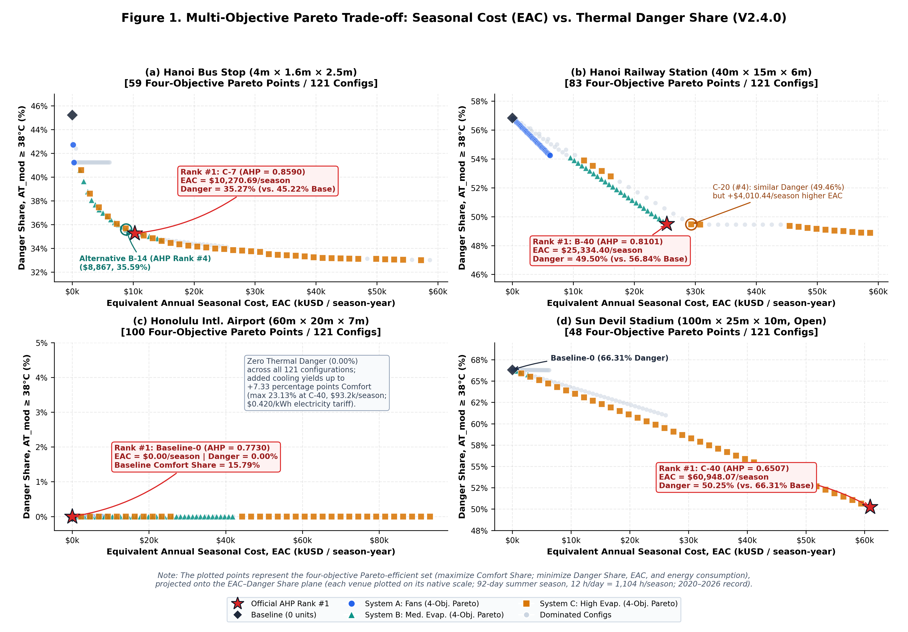

<div align="center">

# Cooling What Matters: A Heat-Moisture Balance Framework for Measuring and Optimizing Cooling in Open-Air and Semi-Open Public Spaces

**COMAP High School Mathematical Contest in Modeling (HiMCM) 2026 — Problem B | Team #19386**

[](https://www.python.org/)
[-0F766E?style=flat-square)](#2-physical-formulation--scaling-law)
[](./02_Code_and_Reproducibility/Reproduction_Log.txt)
[](#24-multi-criteria-effectiveness-pareto--ahp)
[-7C3AED?style=flat-square)](#32-robustness-monte-carlo-oat-sensitivity--extreme-heat)

*An hourly, quasi-steady, one-zone heat-and-moisture balance framework with a served sub-zone, explicit capture ratio, universal coverage scaling law ($\rho = c\,n\,A_{\text{cov}}/A_{\text{floor}} = 1$), 4-objective Pareto + AHP optimization, and multi-layer Monte Carlo robustness analysis.*

[📄 Final Report (PDF)](./01_Final_Report/19386.pdf) • [📊 AHP Rankings (CSV)](./04_Data_and_Results/AHP_Ranking_Official_Team19386_14Nov_v2.4.0.csv) • [🔍 Sensitivity Tracking (CSV)](./04_Data_and_Results/Sensitivity_RankTracking_LeMinh_15Nov_v5.0.csv) • [✅ Validation Audit (CSV)](./04_Data_and_Results/ValidationChecks_Team19386_14Nov_v2.4.0.csv)

</div>

---

## 1. Core Insights & Executive Summary

Open-air and semi-open public venues cool people while exposed to the surrounding atmosphere, losing most conditioned air to ambient infiltration—much like an open-front refrigerated display case, where over **80%** of the cooling load is driven by warm air infiltration across the air curtain. Consequently, cooling performance cannot be judged by rated device capacity or kWh alone; it must be measured by the **useful thermal relief delivered to people**.

Evaluating **7,728 summer operating hours** per site (June–August 2020–2026, 09:00–21:00) across four contrasting venues in three climates (**Hanoi Bus Stop**, **Hanoi Railway Station**, **Honolulu International Airport**, and **Sun Devil Stadium in Tempe/Phoenix**) yields five principal conclusions:

1. **Efficiency Is Not Effectiveness:** At the Hanoi bus stop, a single recirculating fan (`A-1`) is **5× more energy-efficient** than a large evaporative cooler (`C-1`) ($\eta_T = 5.83$ vs. $1.13\ \text{person}\cdot^\circ\text{C}/\text{kWh}$), yet removes only **2.49 pp** of danger-hours versus **4.63 pp** for `C-1`. Selecting a single metric leads to suboptimal investments.
2. **Climate, Not Equipment, Sets Evaporative Value:** Direct evaporative cooling is bounded by wet-bulb depression ($D = T - T_w$). System C reaches its rated $8^\circ\text{C}$ supply drop in **93.1%** of Phoenix operating hours ($D_{\text{mean}} = 17.6^\circ\text{C}$), compared with just **1.2%** in humid Hanoi ($D_{\text{mean}} = 3.8^\circ\text{C}$) and **1.6%** in Honolulu ($D_{\text{mean}} = 5.6^\circ\text{C}$). Safety-weighted efficiency ($\eta_S$) is **85× higher** at Sun Devil Stadium (`C-40`: $15.59$) than at the Hanoi Bus Stop (`C-7`: $0.185$).
3. **Universal Coverage Scaling Law ($\rho = 1$):** Thermal efficiency $\eta_T(n)$ remains flat while each added unit reaches new occupants ($\rho = c\,n\,A_{\text{cov}}/A_{\text{floor}} \le 1$) and decays strictly as $1/n$ once the crowd is saturated ($\rho > 1$). Installing beyond $n^* = A_{\text{floor}}/(c\,A_{\text{cov}})$ buys airflow without reaching new people.
4. **Site-Specific Optima (`cap40` Scan, 484 Configs $\to$ 290 Pareto-Efficient):**
   * **Sun Devil Stadium (Phoenix):** `C-40` (AHP Rank #1, score `0.6507`) cuts danger share from **66.31% $\to$ 50.25%** for **USD 60,948/yr** (USD 3,795/pp); stage 40 units now, verify via pilot, then expand toward `C-104` ($\rho \approx 1$, danger **24.55%**).
   * **Hanoi Railway Station:** `B-40` (AHP Rank #1, score `0.8101`) cuts danger share from **56.84% $\to$ 49.50%** for **USD 25,334/yr** (USD 3,448/pp).
   * **Hanoi Bus Stop:** `C-7` is the mathematical min-max optimum (score `0.8590`, danger **45.22% $\to$ 35.27%**, USD 10,271/yr), whereas **two fans (`A-2`)** represent the physically feasible full-coverage design ($\rho = 1$, danger **41.23%**, **USD 308/yr**, USD 77/pp).
   * **Honolulu International Airport:** **No cooling (`Baseline-0`)** is optimal (score `0.7730`; baseline danger share is already **0.00%**).
5. **Extreme Heat Requires Operations, Not Just Machines:** During the hottest 5% of operating hours ($T \ge 44.3^\circ\text{C}$ in Phoenix, $35.5^\circ\text{C}$ in Hanoi), danger share stays **$\ge 99.1\%$** across every hardware configuration, and $+3^\circ\text{C}$ warming lifts baseline danger to **82–88%**. Hardware must be paired with afternoon scheduling (12:00–17:00 captures 75–83% of hot hours), shade, free hydration, dwell-time limits, and tiered heat alerts.

### Energy-to-Exposure Value Chain

```text
+-------------------+     +-------------------+     +--------------------------------------+
|  Electricity E    | --> | Cooling Produced  | --> | Reaches People (Captured Share phi)  |
|      (kWh)        |     | (dT_sup, v_served)|     | Benefit = dAT_mod x N_served         |
+-------------------+     +-------------------+     | Efficiency eta_T = Benefit / E       |
                                   |                +--------------------------------------+
                                   |
                                   v  (1 - eta_cap: Leakage)
                          +-------------------+     +--------------------------------------+
                          | Swept Away by     | --> | Warm, Moist Ambient Air Re-entrains  |
                          | Ventilation V_inf |     | (Open-Freezer Curtain Analog)        |
                          +-------------------+     +--------------------------------------+
```

---

## 2. Physical Formulation & Scaling Law

### 2.1 Hourly Quasi-Steady Heat & Moisture Balance

Each venue is modeled as a well-mixed background zone coupled to a served sub-zone around the cooling units over $7 \times 92 \times 12 = 7,728$ operating hours ($\Delta t = 1\text{ h}$, no thermal mass). Moist-air properties follow Buck's saturation vapor pressure and Stull's wet-bulb formulation; envelope heat gains combine roof/wall sol-air temperatures, glazing solar gain, internal crowd/equipment loads ($q_s = 75\text{ W/person}$, $q_{\text{lat}} = 55\text{ W/person}$, $P_{\text{tb}} = 100\text{ W}$), and quadrature wind-plus-buoyancy ventilation:

$$T_{\text{sol},r} = T + \frac{\alpha\,\text{GHI}}{h_o} - \Delta T_{\text{sky}}(1 - 0.8\,\text{CC}), \qquad T_{\text{sol},w} = T + \frac{\alpha f_v\,\text{GHI}}{h_o}$$

$$v_{\text{bg}} = \max(k\,\alpha_{\text{sh}} v_{10},\, v_{\text{min}}), \qquad \dot{V}_w = C_d A_{\text{mo}} v_{\text{bg}}, \qquad \dot{V}_b = C_d A_{\text{mo}}\sqrt{\frac{g H \vert{}T_{\text{base}} - T\vert{}}{T + 273.15}}, \qquad \dot{V}_{\text{inf}} = \sqrt{\dot{V}_w^2 + \dot{V}_b^2}$$

$$T_{\text{base}} = \frac{U_r A_r T_{\text{sol},r} + U_w A_w T_{\text{sol},w} + U_g A_g T + \dot{Q}_{\text{glass}} + \dot{Q}_{\text{int}} + H_{\text{vent}} T}{H_{\text{env}} + H_{\text{vent}}}, \qquad H_{\text{vent}} = \rho_{\text{da}} c_p \dot{V}_{\text{inf}}$$

Background humidity ratio $w_{\text{zone}} = \min\{w_{\text{out}} + N q_{\text{lat}} / (h_{fg}\rho_{\text{da}}\max(\dot{V}_{\text{inf}}, 0.05)),\, w_{\text{sat}}(T_{\text{base}})\}$ prevents supersaturation, while the open-air stadium branch sets $T_{\text{base}} = T$ and $w_{\text{zone}} = w_{\text{out}}$.

### 2.2 Cooling Systems & Capture Ratio

* **Evaporative Coolers (`B`: medium $5^\circ\text{C}$ / $1.2\text{ kW}$, `C`: large $8^\circ\text{C}$ / $2.5\text{ kW}$):** Supply cooling is adiabatic ($\epsilon = 0.90$) and capped by wet-bulb depression $D = T - T_w$:

  $$\Delta T_{\text{sup}} = \max\left\{0,\, \min\left[\Delta T_{\text{rated}},\, \epsilon(T - T_w)\right]\right\}, \qquad \dot{m}_{\text{evap}} = \rho_{\text{da}} \dot{V}_{\text{sys}} (w_{\text{sup}} - w_{\text{out}})$$

  $$f_{\text{cov}} = \min\left(1,\, \frac{n A_{\text{cov}}}{A_{\text{floor}}}\right), \qquad f_{\text{people}} = \min(1,\, c f_{\text{cov}}), \qquad \varphi = \text{mix} \cdot \frac{\dot{V}_{\text{sys}}}{\dot{V}_{\text{sys}} + f_{\text{cov}} \dot{V}_{\text{inf}}}, \qquad T_{\text{served}} = T_{\text{base}} - \varphi\,\Delta T_{\text{sup}}$$

  where $\eta_{\text{cap}} = \varphi/\text{mix}$ ($\text{mix} = 0.5$) is the captured fraction of cooled air and $1 - \eta_{\text{cap}}$ is ventilation leakage.
* **Recirculating Fans (`A`: $0.25\text{ kW}$):** Elevates local air speed up to $1.2\text{ m/s}$ without changing $T_{\text{base}}$ or moisture, fading linearly between $33^\circ\text{C}$ and skin temperature ($38^\circ\text{C}$):

  $$f_{\text{fan}} = \text{clip}\left(\frac{38 - T_{\text{base}}}{38 - 33},\, 0,\, 1\right), \qquad v_{\text{served}} = \sqrt{v_{\text{bg}}^2 + (1.2 f_{\text{fan}})^2}$$

### 2.3 Apparent Temperature, Efficiency Metrics & Scaling Law

Human thermal exposure is scored via a team-modified Steadman apparent temperature ($AT_{\text{mod}}$, in $^\circ\text{C}$), classifying each person-hour into **Comfort** ($AT_{\text{mod}} \le 28^\circ\text{C}$), **Stress** ($28 < AT_{\text{mod}} < 38^\circ\text{C}$), or **Danger** ($AT_{\text{mod}} \ge 38^\circ\text{C}$):

$$AT_{\text{mod}} = T + 0.348 e - 0.70 v + \frac{0.70\, Q_g}{v + 10} - 4.25, \qquad Q_g = 0.1333\, f_{\text{sun}}\,\text{GHI}$$

Two complementary efficiency metrics quantify thermal relief and safety dose avoided per unit electricity ($E_{\text{kWh}} = n P_{\text{unit}} h_{\text{season}}$):

$$\eta_T = \frac{\sum_t N_{\text{served}}(t)\,\Delta AT_{\text{mod}}(t)}{E_{\text{kWh}}} \quad [\text{person}\cdot^\circ\text{C}/\text{kWh}], \qquad \eta_S = \frac{\text{EDH}_{38}^{\text{base}} - \text{EDH}_{38}^{\text{cfg}}}{E_{\text{kWh}}} \quad [\text{person}\cdot^\circ\text{C}\cdot\text{h}/\text{kWh}]$$

$$\text{EDH}_{38} = \frac{1}{7} \sum_t \left[ N_{\text{served}}(AT_{\text{mod}}^s - 38)^+ + N_{\text{unserved}}(AT_{\text{mod}}^u - 38)^+ \right]$$

**Coverage Scaling Law:** Defining the people-coverage ratio $\rho = c\,n\,A_{\text{cov}}/A_{\text{floor}}$, efficiency obeys:

$$\eta_T(n) = \begin{cases} \eta_T(1), & \rho \le 1 \\ \eta_T(1)/\rho, & \rho \ge 1 \end{cases}$$

### 2.4 Multi-Criteria Effectiveness (Pareto + AHP)

Equivalent Annual Cost ($\text{EAC}$, in USD/season-year) combines annualized capital ($r = 6\%$, $L = 10\text{ yr}$, $\text{CRF} = 0.1359$), maintenance ($m = 5\%$), electricity, and water:

$$\text{EAC} = n(C_k + I_k)(\text{CRF} + m) + E_{\text{kWh}} p_{\text{el}} + V_{\text{water}} p_w$$

Non-dominated configurations (**290 of 484** under `cap40`) are normalized to $[0, 1]$ per venue and scored via Analytic Hierarchy Process (AHP) weights ($\lambda_{\max} = 4.0104$, $\text{CR} = 0.0038 < 0.10$):

1. **Safety (Minimize Danger Share, $AT_{\text{mod}} \ge 38^\circ\text{C}$):** `0.4236`
2. **Comfort (Maximize Comfort Share, $AT_{\text{mod}} \le 28^\circ\text{C}$):** `0.2270`
3. **Cost (Minimize Equivalent Annual Cost, EAC):** `0.2270`
4. **Energy (Minimize Seasonal Electricity, kWh):** `0.1223`

---

## 3. Benchmarks, Resource Footprints & Robustness

### 3.1 Official Deterministic Recommendations & Environmental Footprints (`cap40` vs. Full-Coverage)

| Venue (Climate & Geometry) | Recommended Option | AHP Score | Danger Share (Base $\to$ New) | Comfort Share | $\eta_T$ / $\eta_S$ | Energy (MWh) & $\text{CO}_2$ (t) | Water ($\text{m}^3$) | EAC (USD/yr) | Marginal Cost (USD/pp) |
| :--- | :--- | :---: | :---: | :---: | :---: | :---: | :---: | :---: | :---: |
| **Sun Devil Stadium, Tempe**<br>(Hot-arid, $2,500\ \text{m}^2$ open) | **C-40** (`cap40` #1)<br>**C-104** (Phase 2, $\rho \approx 1$) | `0.6507`<br>`0.6530` | 66.31% $\to$ **50.25%**<br>66.31% $\to$ **24.55%** | 2.63%<br>5.65% | 33.60 / **15.59**<br>33.60 / **15.59** | 110.4 / 35.2 t<br>287.0 / 91.6 t | 1,591<br>4,137 | 60,948<br>158,465 | 3,795<br>3,795 |
| **Hanoi Railway Station**<br>(Hot-humid, $600\ \text{m}^2$ semi-open) | **B-40** (`cap40` #1)<br>**A-100** (Fan alt.) | `0.8101`<br>— | 56.84% $\to$ **49.50%**<br>56.84% $\to$ **50.34%** | 0.00%<br>0.00% | 1.22 / **0.820**<br>1.83 / **0.820** | 53.0 / 34.9 t<br>27.6 / 18.2 t | 344<br>0 | 25,334<br>15,388 | 3,448<br>2,367 |
| **Hanoi Bus Stop**<br>(Hot-humid, $6.4\ \text{m}^2$ shelter) | **C-7** (Math `cap40` #1)<br>**A-2** (Practical $\rho = 1$) | `0.8590`<br>`0.8690`* | 45.22% $\to$ **35.27%**<br>45.22% $\to$ **41.23%** | 0.02%<br>0.00% | 0.32 / **0.185**<br>4.66 / **1.690** | 19.3 / 12.7 t<br>0.55 / 0.36 t | 129<br>0 | 10,271<br>308 | 1,032<br>**77** |
| **Honolulu Int'l Airport**<br>(Mild-humid, $1,200\ \text{m}^2$) | **Baseline-0** (`cap40` #1)<br>**C-14** (Targeted comfort) | `0.7730`<br>— | 0.00% $\to$ **0.00%**<br>0.00% $\to$ **0.00%** | 15.79%<br>18.36% | — / Undef<br>2.01 / Undef | 0.0 / 0.0 t<br>38.6 / 26.1 t | 0<br>398 | 0<br>32,622 | —<br>11,719/comf pp |

*\*`A-2` is the optimal configuration under both the full-coverage cap ($\rho = 1$) and absolute-scale scoring, avoiding the physical impossibility of mounting seven System C units on a $6.4\ \text{m}^2$ shelter roof.*

### 3.2 Robustness: Monte Carlo, OAT Sensitivity & Extreme Heat

| Venue & Selected Config | MC $10^6$ Paired $\Delta\text{Danger}$ [95% Block-Bootstrap CI] | MC 10k Param+Weather Mean (SD) | OAT Rank Shifts (of 56) | AHP Weight Shifts ($\pm 20\%$, 9 tests) | $+2^\circ\text{C}$ Warming Danger (Const. RH) | Hottest 5% Hours Danger |
| :--- | :---: | :---: | :---: | :---: | :---: | :---: |
| **Sun Devil Stadium (`C-40`)** | **-15.9 pp** [-16.9, -15.0] | 50.4% (2.7 pp) | **0 / 56** | Retained **9 / 9** | 82.4% $\to$ **68.3%** | 100.0% $\to$ **99.7%** |
| **Hanoi Railway Station (`B-40`)** | **-7.5 pp** [-8.1, -6.7] | 49.6% (2.8 pp) | **5 / 56** | Retained **9 / 9** | 91.2% $\to$ **88.5%** | 100.0% $\to$ **99.5%** |
| **Hanoi Bus Stop (`C-7` / `A-2`)** | **-10.1 pp** [-11.2, -8.7] | 36.1% (3.3 pp) / 41.9% (2.4 pp) | **13 / 56** | Retained **9 / 9** | 85.4% $\to$ **80.5%** | 100.0% $\to$ **99.1%** |
| **Honolulu Airport (`Baseline-0`)** | **0.0 pp** (0% baseline) | 0.0% (0.0 pp) | **2 / 56** | Retained **9 / 9** | 0.9% $\to$ **0.9%** | 0.0% $\to$ **0.0%** |

* **Automated Verification (`13 / 13` Passed):** Zero-load energy conservation holds to $7 \times 10^{-15}\ \text{K}$; evaporative supply temperature never undercuts wet-bulb temperature (minimum margin $+0.14^\circ\text{C}$); an independent vectorized port reproduces all 290 Pareto-efficient configurations to $5 \times 10^{-10}$; and deterministic execution completes in ~5.7 seconds with `0.0e+00` deviation across all 484 rows.

---

## 4. Visual Benchmarks & Verification Dossiers

Each primary figure is backed by an independent PDF audit dossier in `./03_Verification_and_Figures/` containing underlying data tables and invariance checks:

### Figure 1: Four-Objective `cap40` Pareto Frontiers ([Verification Dossier PDF](./03_Verification_and_Figures/Figure_1_Verification_Dossier_V2.4.0.pdf))


### Figure 2: $\text{EDH}_{38}$ Electricity Efficiency & Occupancy-Weighted $AT_{\text{mod}}$ Distributions ([Verification Dossier PDF](./03_Verification_and_Figures/Figure_2_Verification_Dossier_V2.4.0.pdf))


### Figure 3: AHP Weight Perturbation ($\pm 20\%$) & Operating-Season Sensitivity ([Verification Dossier PDF](./03_Verification_and_Figures/Figure_3_Verification_Dossier_V2.4.0.pdf))


---

## 5. Operator Guidelines & Tiered Extreme-Heat Protocol

1. **Match Technology to Wet-Bulb Depression ($D = T - T_w$):** Rated evaporative drops require $\epsilon D \ge \Delta T_{\text{rated}}$, i.e., $D \ge 5.6^\circ\text{C}$ for System B and $D \ge 8.9^\circ\text{C}$ for System C. Use evaporative cooling in arid climates (Tempe: 97%/93% of hours); prefer fans, shade, and ventilation in humid climates (Hanoi: 19%/1.2%).
2. **Size to Coverage ($\rho \approx 1$) & Contain Cooled Jets:** Cap installation count at $n^* = A_{\text{floor}}/(c\,A_{\text{cov}})$ and position units near occupied waiting zones shielded from crosswinds.
3. **Operate on Demand (12:00–17:00 Window):** 75–83% of hot hours occur between 12:00 and 17:00; run evaporative coolers only when $D \ge 3^\circ\text{C}$ and the zone is occupied, and switch to fans below the $33^\circ\text{C}$ fade-in.
4. **Enforce a Tiered Extreme-Heat Protocol** keyed to each venue's 95th-percentile operating temperature ($P_{95}$: Hanoi $35.5^\circ\text{C}$, Honolulu $29.7^\circ\text{C}$, Tempe $44.3^\circ\text{C}$):
   * **Tier 0 — Normal ($T < P_{90}$):** On-demand cooling; shade and drinking-water stations open.
   * **Tier 1 — Watch ($T \ge P_{90}$ or $D$ below rating):** Pre-cool 1 hour prior to peak crowd arrival; verify water reserves; deploy extra free drinking water.
   * **Tier 2 — Alert ($T \ge P_{95}$):** Full airflow across 11:00–18:00; shaded queuing; dwell-time advisories; staffed first-aid stations; shift scheduled events to evening where feasible.
   * **Tier 3 — Emergency ($T \ge P_{95} + 2^\circ\text{C}$ or official heat warning):** Cap crowd density or delay entry; open air-conditioned refuge areas; actively monitor vulnerable groups.

---

## 6. Repository Structure

```text
HiMCM_2026_ProblemB_19386/
├── 01_Final_Report/
│   └── 19386.pdf                                              # Official COMAP HiMCM 2026 Problem B submission
├── 02_Code_and_Reproducibility/
│   ├── PhysicalModel_LeMinh_13Nov_v1.0.py                   # Deterministic hourly solver, Pareto, AHP & OAT
│   ├── MonteCarloV24_GiaPhu_15Nov_v1.py                     # Parallel 10,000-run Monte Carlo engine (seed=42)
│   ├── MANIFEST_SHA256.txt                                  # SHA-256 checksums for inputs, code & outputs
│   ├── Reproduction_Log.txt                                 # Python 3.13.18 verification log (13/13 passed)
│   └── Team19386_Final_Technical_Package_16Nov2026_v1_LITE/ # Weather CSVs, parameter workbook & test harness
├── 03_Verification_and_Figures/
│   ├── fig01_pareto_tradeoff.png                            # Fig 1: Four-objective cap40 Pareto frontiers
│   ├── Figure_1_Verification_Dossier_V2.4.0.pdf             # Audit verification dossier for Figure 1
│   ├── fig02_edh38_efficiency.png                           # Fig 2: EDH38 efficiency & AT_mod histograms
│   ├── Figure_2_Verification_Dossier_V2.4.0.pdf             # Audit verification dossier for Figure 2
│   ├── fig03_ahp_season_sensitivity.png                     # Fig 3: ±20% AHP weights & season scaling
│   └── Figure_3_Verification_Dossier_V2.4.0.pdf             # Audit verification dossier for Figure 3
└── 04_Data_and_Results/
    ├── AHP_Ranking_Official_Team19386_14Nov_v2.4.0.csv      # Official V2.4.0 AHP scores & rankings (484 rows)
    ├── Sensitivity_RankTracking_LeMinh_15Nov_v5.0.csv       # Rank reversal tracking across 56 OAT cases
    └── ValidationChecks_Team19386_14Nov_v2.4.0.csv          # Automated audit & invariant checks (10/10 True)
```

---

## 7. Installation & Reproducibility

### 7.1 Environment Setup

Tested on **Python 3.13.18 (Linux)**. Install the required scientific computing dependencies:

```bash
pip install numpy==2.5.3 pandas==3.0.5 matplotlib==3.11.2 seaborn==0.13.2 reportlab==5.0.1 openpyxl==3.1.5
```

### 7.2 Running the Deterministic & Monte Carlo Pipelines

1. **Deterministic V2.4.0 Solver (`cap40` sweep, Pareto screening, AHP & OAT sensitivity):**
   Place the standardized parameter workbook (`THONG_SO_THONG_NHAT_CHUAN_100_v2.3.2 (1).xlsx`) and the three Open-Meteo hourly CSV files (`Weather Data_Ga_Ha_Noi_GiaPhu_08Nov_v1(1).csv`, `WeatherData_Honolulu_International_Airport_GiaPhu_08Nov_v1(1).csv`, `WeatherData_Sun_Devil_Stadium_GiaPhu_08Nov_v1(2).csv`) inside `<DATA_DIR>` (bundled inside `02_Code_and_Reproducibility/Team19386_Final_Technical_Package_16Nov2026_v1_LITE/`), then run:

   ```bash
   python3 02_Code_and_Reproducibility/PhysicalModel_LeMinh_13Nov_v1.0.py \
     --data-dir <DATA_DIR> \
     --workbook "THONG_SO_THONG_NHAT_CHUAN_100_v2.3.2 (1).xlsx" \
     --max-units 40
   ```

2. **10,000-Run Stochastic Monte Carlo Simulation (`seed = 42`):**
   Ensure the extended model wrapper (`ModelExt_LeMinh_15Nov_v1.py`) and official V2.4.0 context variables (`HIMCM_MODEL`, `HIMCM_RUN_DIR`, `HIMCM_WORKBOOK`, `HIMCM_OUT`) are configured, then execute:

   ```bash
   export HIMCM_OUT=./mc_outputs
   python3 02_Code_and_Reproducibility/MonteCarloV24_GiaPhu_15Nov_v1.py
   ```

3. **SHA-256 Checksum Verification:**

   ```bash
   cd 02_Code_and_Reproducibility && sha256sum -c MANIFEST_SHA256.txt
   ```

---

## 8. Scope, Limitations & Caveats

* **Reduced-Order One-Zone Physics:** Resolves hourly quasi-steady heat-and-moisture balances without thermal mass, radiant view-factor exchange, or 3D CFD jet plumes.
* **Open-Air Stadium Upper Bound:** The stadium branch sets $T_{\text{base}} = T_{\text{out}}$ with zero ventilation leakage, making `B-40` and `C-40` reductions upper bounds; under rail-station capture ($\eta_{\text{cap}} = 0.72$), realized relief scales proportionally.
* **Internal Comparative Index ($AT_{\text{mod}}$):** $AT_{\text{mod}}$ with $28^\circ\text{C} / 38^\circ\text{C}$ thresholds is an internal operating metric rather than clinical UTCI or NWS Heat Index standards.
* **Uncalibrated Planning Inputs:** Equipment prices, utility tariffs, and coupling coefficients ($C_d$, $\alpha_{\text{sh}}$, $\text{mix}$, $c$) are planning-level assumptions requiring pilot sensor calibration prior to large-scale procurement.

---

## 9. Team & Authorship

**COMAP HiMCM 2026 Team #19386** — High School for the Gifted, Vietnam National University Ho Chi Minh City (VNU-HCM):

* **Lê Nghiêm Gia Phú (Team Leader):** Project coordination; mathematical formulation of the Cooling-Efficiency ($\eta_T, \eta_S$), Coverage Scaling Law ($\rho = 1$), and Semi-Open Rail Station models; design and execution of the 10,000-scenario Monte Carlo simulation (`MonteCarloV24_GiaPhu_15Nov_v1.py`); authorship of the public-facing Blog Post.
* **Lê Minh:** Python implementation of the deterministic V2.4.0 solver (`PhysicalModel_LeMinh_13Nov_v1.0.py`), `cap120` sweeps, 56-case OAT sensitivity scripts, vectorized verification port, and SHA-256 audit tables.
* **Đỗ Lê Chí Hùng:** Literature synthesis (`Freezer` & biophysical fan studies), equipment specification verification, and report drafting.
* **Trần Hưng Phát:** Open-Meteo data preprocessing, triangular occupancy profile parameterization, and executive COO memorandum / operator guidelines drafting.

## Citation

```bibtex
@techreport{team19386_himcm2026,
  title       = {Cooling What Matters: A Heat-Moisture Balance Framework for Measuring and Optimizing Cooling in Open-Air and Semi-Open Public Spaces},
  author      = {Le, Nghiem Gia Phu and Le, Minh and Do, Le Chi Hung and Tran, Hung Phat},
  institution = {Consortium for Mathematics and Its Applications (COMAP) High School Mathematical Contest in Modeling (HiMCM), Team \#19386},
  year        = {2026},
  month       = {November},
  note        = {Problem B Final Solution Paper}
}
```
